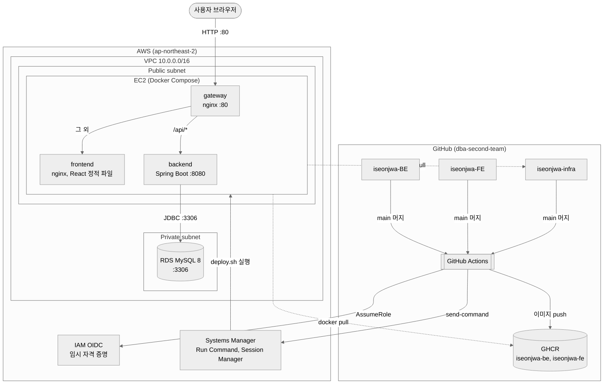

# iseonjwa-infra
이선좌 서비스 배포 구성

## 시스템 구조

### 네트워크 접근 규칙
| 대상 | 인바운드                  | 비고                                |
|---|-----------------------|-----------------------------------|
| EC2 보안 그룹 | 80/TCP ⬅️ 0.0.0.0/0   | 접속은 Session Manager (SSH(22) 미개방) |
| RDS 보안 그룹 | 3306/TCP ⬅️ EC2 보안 그룹 | 프라이빗 서브넷              |
| backend, frontend 컨테이너 | Docker 네트워크 내부만       | 외부 포트 미노출, gateway만 :80 공개        |

### 배포 흐름

| 레포 | 동작                                                                  |
|---|---------------------------------------------------------------------|
| iseonjwa-BE | 테스트 ➡️ 이미지 빌드 & GHCR push ➡️ SSM으로 `deploy.sh backend` 실행           |
| iseonjwa-FE | 빌드 ➡️ 이미지 빌드 & GHCR push ➡️ SSM으로 `deploy.sh frontend` 실행           |
| iseonjwa-infra | compose, nginx 설정 검사 ➡️ SSM으로 `docker compose up -d` + nginx reload |

- GitHub에는 AWS 액세스 키를 저장하지 않고, OIDC로 실행할 때마다 임시 자격 증명을 받습니다.
- 이미지는 커밋 해시로 태깅하며, 서버의 `.env`에 현재 배포된 태그가 기록됩니다.